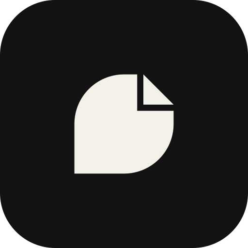
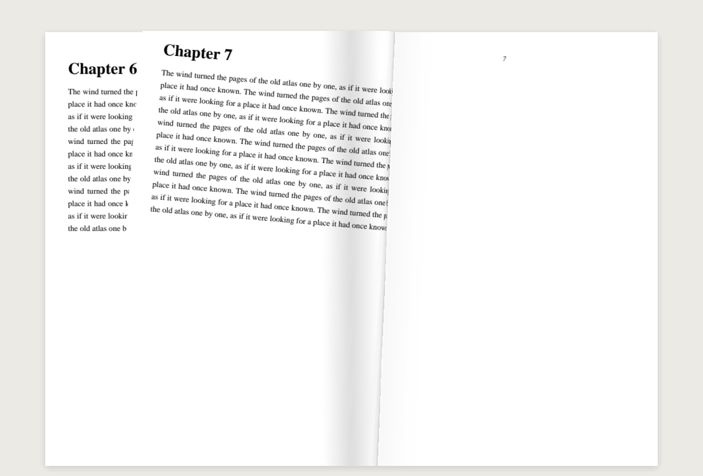
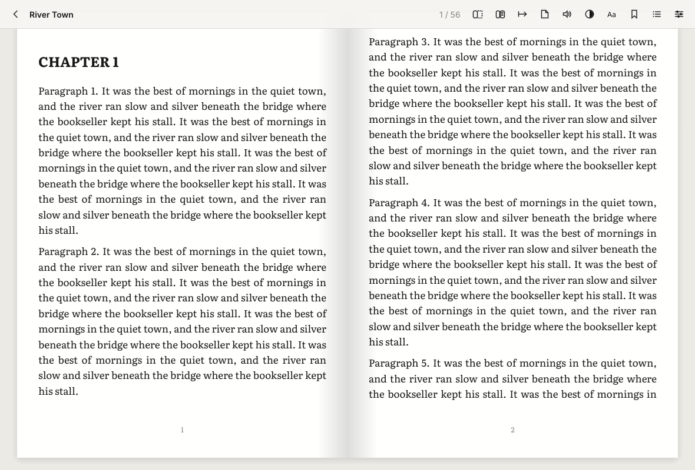
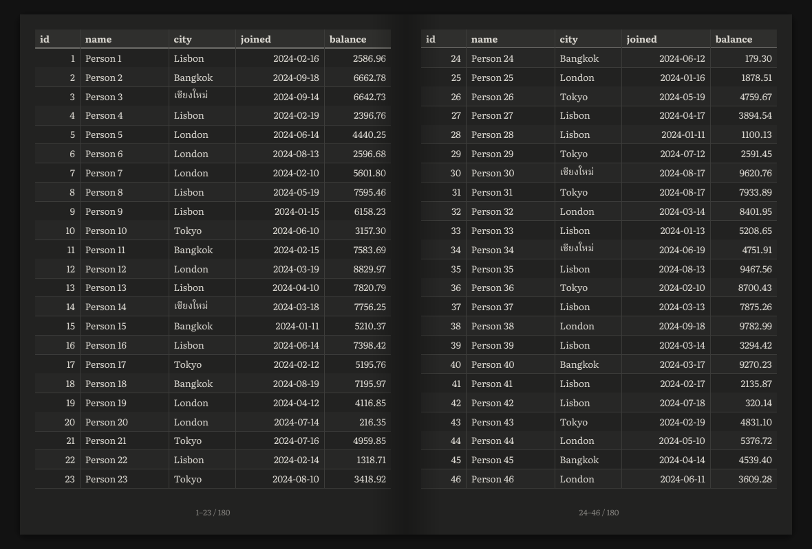
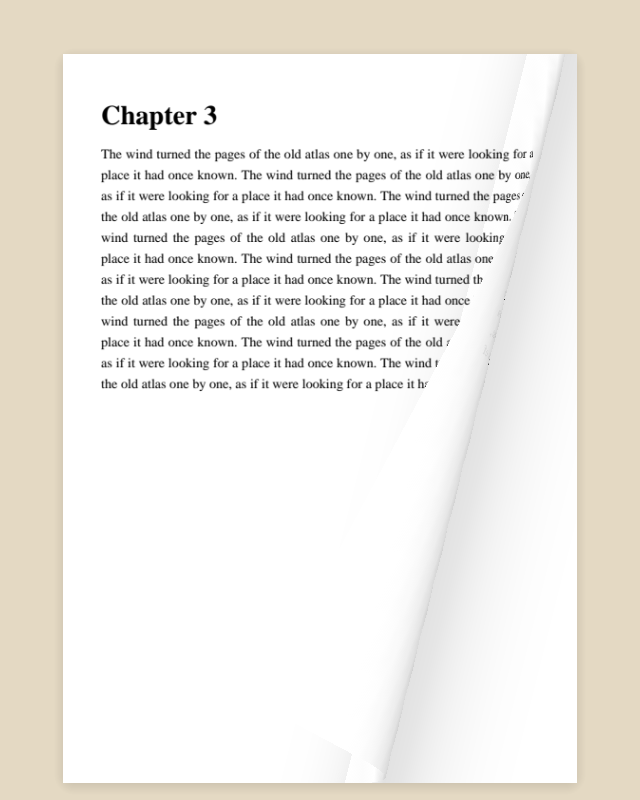
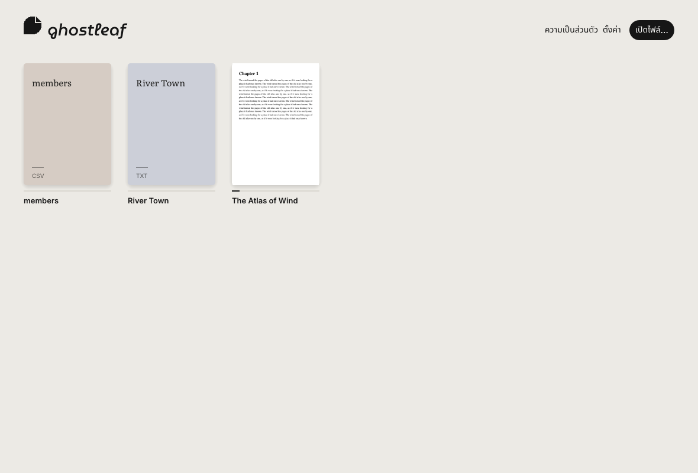

<p align="center">
  
</p>

<h1 align="center">ghostleaf</h1>

<p align="center">
  A private, offline reader with a page that turns like paper,<br>
  and disappears the moment you look away.
</p>

<p align="center">
  <b>Windows</b> · Linux · macOS · <b>Android</b> (in progress, <a href="docs/ANDROID.md">docs/ANDROID.md</a>) · <i>iOS planned</i><br>
  Written in Rust · MIT OR Apache-2.0
</p>

---



## Features

**v1 (Windows first): PDF, TXT, CSV**

- **Stealth reading.** The window hides instantly when the mouse leaves it, and comes back when it returns. Choose a plain veil, a neutral spreadsheet decoy, or minimize. Optional hide-on-focus-loss, click-to-reveal, a delay, a neutral window title, and a global boss key **Ctrl+Alt+H**.
- **Realistic page curl.** Grab any corner or edge and peel. The sheet bends around a cylinder, shows the next page on its back (or see-through paper in single-page mode), casts soft shadows, and uses spring physics: fling it to turn, let go early and it falls back. Also *Slide* and *None*.
- **Paper sounds.** Recorded page turns (flip, hand peel, landing) with a one-key mute (**M**). See [docs/SOUNDS.md](docs/SOUNDS.md); builds without the recordings fall back to synthesized paper.
- **Pages.** Single page, two-page spread, or *Auto* (spread when the window is wide), plus a **first blank page** (flyleaf) toggle in the top bar so spreads pair correctly.
- **Reading direction.** Left-to-right, or right-to-left for Arabic and manga, per book.
- **Themes.** Light, Paper, Sepia, Tan, Dusk, Dark, Black, and **Custom**: any tint colour at any strength from 0 to 100%. Optionally recolour PDF pages in dark themes.
- **Window.** The title bar can match the theme (Windows 11), stay as the system draws it, or be **hidden**, with Ghostleaf's own minimal window controls.
- **Typography for text files.** Font (bundled Literata, Inter, Noto Serif/Sans Thai, or any installed font), size, line height, paragraph spacing, margins, justification, indent, and joining of hard-wrapped lines.
- **Formats.**
  - **PDF**: rendered by PDFium with the PDF's own embedded fonts. Outline becomes the table of contents.
  - **TXT**: encoding detection (UTF-8/16, TIS-620/Windows-874 Thai, GBK, Shift-JIS…), chapter detection (`Chapter 1`, `บทที่ 1`, `第一章`), and real Thai word breaking.
  - **CSV/TSV**: a paginated table with the header on every page, an auto-detected delimiter, and wide tables split into column groups.
- **Library.** Covers, progress, drag and drop, bookmarks (**B**), table of contents, go to page.
- **English and Thai** interface.

| | |
|---|---|
|  |  |
|  |  |

## Private by design

- **No network code at all.** No HTTP, TLS or sockets. CI enforces this with [`cargo-deny`](deny.toml).
- No accounts, telemetry, ads or update checks.
- Your books are **never copied or uploaded**. Ghostleaf remembers only a book's path, title, reading position and bookmarks, plus optional small PDF cover thumbnails, as plain JSON in one folder.
- The in-app **Privacy** screen lists every stored file and lets you forget a book or erase everything.

Details: [PRIVACY.md](PRIVACY.md).

## Build and run (Windows)

Requirements: [Rust](https://rustup.rs) (stable, MSVC toolchain) and the *Visual Studio Build Tools* (C++ workload) that rustup asks for.

```powershell
git clone https://github.com/ChRatchapol/Ghostleaf.git
cd Ghostleaf
powershell -ExecutionPolicy Bypass -File scripts\fetch-pdfium.ps1   # one-time: PDF engine
cargo run --release
```

To make a portable zip (`ghostleaf.exe` + `pdfium.dll` + licences) in `dist\`:

```powershell
powershell -ExecutionPolicy Bypass -File scripts\package-windows.ps1
```

Put an empty `portable.flag` next to `ghostleaf.exe` to keep all data beside the app.

macOS / Linux: `./scripts/fetch-pdfium.sh && cargo run --release`. On Linux, install `libasound2-dev` and `libgtk-3-dev` first.

The default renderer is wgpu (DirectX 12 / Vulkan / Metal). Set `GHOSTLEAF_RENDERER=glow` to use OpenGL instead.

## Downloads

Ready-to-run Windows and Linux builds are attached to each [GitHub Release](https://github.com/ChRatchapol/Ghostleaf/releases): unzip and run, nothing to install. Verify downloads with `SHA256SUMS.txt`. How releases are made: [docs/RELEASING.md](docs/RELEASING.md).

## Keyboard

| Key | Action |
|---|---|
| → / ← · PgDn / PgUp · Space | Next / previous page (arrows follow the reading direction) |
| Home / End | First / last page |
| B | Bookmark this page |
| M | Mute or unmute paper sounds |
| Ctrl+Alt+H | Boss key: hide or show (global) |
| Mouse wheel · click page edges | Turn pages |

## Project layout

```
app/                 the desktop app (eframe/egui): reader, curl drawing, stealth, library, settings
crates/gl-core       settings, library model, local storage (plain JSON)
crates/gl-formats    PDF (PDFium), TXT, CSV: pagination and page rendering (cosmic-text)
crates/gl-curl       page-curl geometry and spring physics (renderer-agnostic, unit-tested)
branding/            logo
docs/PLAN.md         product and technical plan, roadmap (EPUB, MOBI, CBZ, 3D shelves, mobile…)
```

## Roadmap

v1.1 macOS + Linux releases · v1.2 EPUB + CBZ + deeper customization · v1.3 MOBI/AZW/AZW3 · v1.4 3D bookshelf, highlights, search, TTS · v2.0 Android + iOS. See [docs/PLAN.md](docs/PLAN.md).

## Licence

Dual-licensed under [MIT](LICENSE-MIT) or [Apache-2.0](LICENSE-APACHE), at your option.
Bundled fonts are under the SIL Open Font License, and PDFium is BSD-licensed. See [THIRD_PARTY.md](THIRD_PARTY.md).
